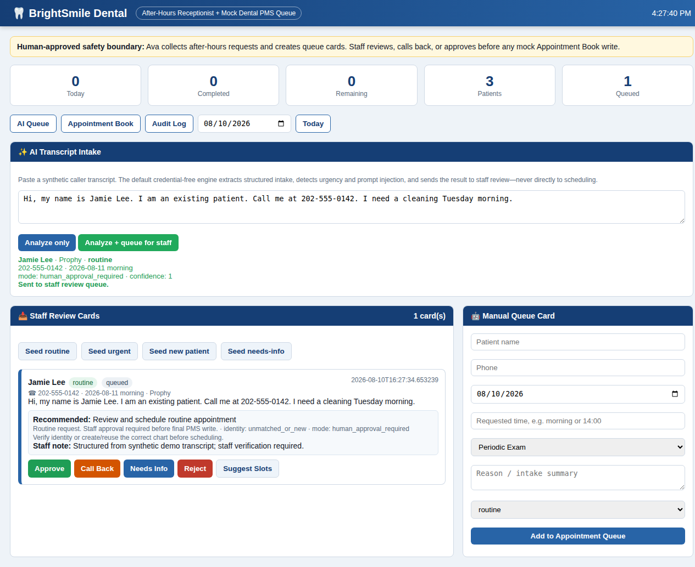

# Dental AI Receptionist


A privacy-conscious **after-hours dental intake and staff-approval workflow** built with FastAPI, SQLite, structured AI extraction, a deterministic safety policy, and a mock dental practice-management dashboard.

> **Portfolio/demo software only.** It uses synthetic patients and a mock PMS. It is not a live integration, medical device, or claim of HIPAA compliance.



## Why this project exists

Dental offices lose after-hours calls, while unconstrained AI should not diagnose patients or write directly to scheduling systems. This project demonstrates a safer pattern:

```text
caller transcript
      │
      ▼
structured intake extraction ──► safety and prompt-injection checks
      │
      ▼
staff review queue ──► approve / call back / needs info / reject
      │
      ▼
verified patient + safe slot ──► mock appointment book
```

The AI prepares work. A human approves consequential scheduling actions.

## Demonstrated capabilities

- Transcript → structured appointment intake
- Credential-free deterministic engine for reproducible demos and CI
- Optional OpenAI-compatible structured extraction for **synthetic data only**
- Urgent-language escalation and emergency flags
- Prompt-injection detection; transcript instructions are treated as untrusted caller data
- Existing/new-patient intake and identity-confidence labels
- Staff approval queue with suggested slots
- Approval-gated scheduling into a mock PMS
- Audit trail for queue and appointment actions
- Embedded staff dashboard and OpenAPI documentation
- Regression evaluations for routine, urgent, incomplete, and adversarial transcripts
- Synthetic data only; no production credentials or patient records

## Quick start

### Docker

```bash
git clone https://github.com/MarkT713/dental-ai-receptionist.git
cd dental-ai-receptionist
docker compose up --build
```

Open:

- Dashboard: <http://localhost:8000>
- API docs: <http://localhost:8000/docs>

### Python

Requires Python 3.11+.

```bash
python -m venv .venv
source .venv/bin/activate
pip install -e '.[dev]'
DENTAL_SEED_DEMO_DATA=true uvicorn main:app \
  --app-dir practice_management_software --host 127.0.0.1 --port 8000
```

## Try the AI workflow

Use the **AI Transcript Intake** panel in the dashboard, or call the API:

```bash
curl -s http://localhost:8000/ai/intake/queue \
  -H 'content-type: application/json' \
  -d '{"transcript":"Hi, my name is Jamie Lee. I am an existing patient. Call me at 202-555-0142. I need a cleaning Tuesday morning."}'
```

The request is analyzed and queued for staff review. It is **not** booked directly.

## Tests and evaluations

```bash
pytest -q
python scripts/run_evals.py
```

Verified baseline at publication:

- `14` automated tests passing
- `5/5` evaluation cases passing
- `16/16` field assertions matched

The evaluation set is intentionally small and synthetic. It is a regression suite, not clinical validation.

`docs/ci.yml.example` contains a ready-to-enable GitHub Actions workflow for linting, tests, evaluations, compilation, and container builds.

## Optional model provider

The default `AI_PROVIDER=deterministic` needs no API key. To test an OpenAI-compatible provider with synthetic transcripts:

```bash
cp voice_pipeline/.env.example .env
# Set AI_PROVIDER=openai_compatible, LLM_API_KEY, and
# ALLOW_CLOUD_SYNTHETIC_DATA=true.
```

Never put real patient data in this public demo or send it to a cloud model without an appropriate compliance program, contracts, access controls, retention policy, and vendor review.

## Repository map

```text
practice_management_software/
  main.py                 FastAPI API, SQLite model, and staff dashboard
  intake_engine.py        Structured extraction and safety classification
voice_pipeline/
  voice_bridge.py         Deterministic receptionist conversation state machine
  pms_client.py           Narrow PMS API adapter
scripts/
  run_after_hours_demo.py Repeatable queue demonstration
  run_evals.py            Structured intake regression evaluator
evals/cases.json          Synthetic evaluation cases
tests/                    API, safety, queue, and conversation tests
docs/                     Architecture, privacy, threat model, screenshot
```

## Safety boundaries

- Urgent clinical language stops automated scheduling.
- Missing identity/contact data forces staff follow-up.
- Transcript content cannot authorize tools or override system policy.
- AI-created queue cards require staff approval.
- Scheduling additionally requires an exact matched demo patient.
- The mock PMS is isolated from real dental systems.

See [Architecture](docs/ARCHITECTURE.md), [Privacy](docs/PRIVACY.md), and [Threat Model](docs/THREAT_MODEL.md).

## Honest limitations

- The public repository demonstrates browser and console intake; it does not ship a production phone carrier configuration or full-duplex audio bridge.
- Authentication/RBAC are not implemented; bind locally and do not expose this demo to the internet.
- SQLite and the embedded UI are appropriate for a portfolio sandbox, not a multi-office deployment.
- Safety rules are illustrative and require office-specific legal and clinical review.
- No real Eaglesoft, Dentrix, or other PMS integration is included or implied.
- This software is not HIPAA compliant merely because it has privacy-conscious design.

## Trademark notice

This project is independent and is not affiliated with or endorsed by Patterson, Eaglesoft, Dentrix, Henry Schein, or any dental software vendor. Product names belong to their respective owners.

## License

MIT — see [LICENSE](LICENSE).
