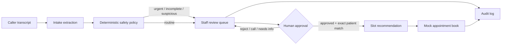

# Architecture

## Components

### Intake extraction

`practice_management_software/intake_engine.py` converts an untrusted transcript into a typed record containing identity/contact fields, scheduling preferences, appointment type, risk, safety flags, confidence, and the engine used.

The default deterministic implementation keeps the demo reproducible and credential-free. An optional OpenAI-compatible implementation is explicitly gated for synthetic data.

### Policy boundary

The extraction engine does not decide whether an appointment can be written. Deterministic API rules enforce:

1. urgent language → stop and escalate;
2. missing callback details → staff follow-up;
3. every AI intake → queue card;
4. scheduling requires staff-approved status;
5. scheduling requires an exact matched demo patient;
6. all writes create audit events.

### PMS adapter

`voice_pipeline/pms_client.py` exposes only narrow operations needed by the receptionist. It does not provide shell access or unrestricted GUI control.

### Data model

SQLite tables model synthetic patients, appointments, appointment requests, and audit events. The database is generated at runtime and excluded from Git.

## Production evolution

A production implementation would add authenticated users, role-based authorization, encrypted storage and backups, scoped vendor credentials, a BAA-eligible deployment, retention controls, observability with sensitive-field suppression, queue ownership, idempotency keys, rate limits, and a validated phone/audio transport.
