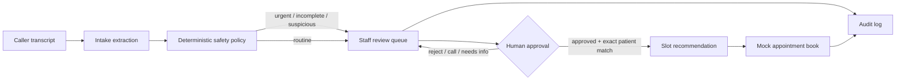

# Architecture

## Components

### Intake extraction

`practice_management_software/intake_engine.py` converts an untrusted transcript into a typed record containing identity/contact fields, scheduling preferences, appointment type, language, risk, safety flags, confidence, and the engine used. English and limited Spanish examples are covered; this is not unrestricted multilingual understanding.

The default deterministic implementation keeps the demo reproducible and credential-free. An optional OpenAI-compatible implementation is explicitly gated for synthetic data. Deterministic urgent and prompt-injection flags are reapplied after provider output, and provider-selected tool modes cannot bypass human approval.

### Policy boundary

The extraction engine does not decide whether an appointment can be written. Deterministic API rules enforce:

1. urgent language → stop and escalate;
2. missing callback details → staff follow-up;
3. every AI intake → queue card;
4. scheduling requires staff-approved status;
5. scheduling requires an exact matched demo patient;
6. duration-aware overlap checks run inside the scheduling transaction;
7. queue scheduling retries are idempotent;
8. all writes create privacy-reduced audit events.

### Access and operations

Optional Bearer-token authorization provides viewer, staff, and manager roles for deployment demonstrations. Request middleware adds IDs, latency, route/status metrics, rate limiting, cache prevention, clickjacking protection, and a content-security policy. The aggregate `/metrics` endpoint contains no request bodies or patient fields.

These shared static role tokens are intentionally simpler than production identity. See [Deployment](DEPLOYMENT.md).

### PMS adapter

`voice_pipeline/pms_client.py` exposes only narrow operations needed by the receptionist. It does not provide shell access or unrestricted GUI control.

`voice_pipeline/adapters.py` defines provider-neutral STT/TTS contracts and a testable turn runtime. Included adapters process synthetic UTF-8 bytes only; unconfigured live transports fail closed.

### Data model

SQLite tables model synthetic patients, appointments, appointment requests, and audit events. The database is generated at runtime and excluded from Git.

## Production evolution

A production implementation would replace shared demo tokens with named users, MFA, revocation, and tenant-aware RBAC; replace process-local metrics/rate limits with managed infrastructure; add encrypted storage/backups and queue ownership; and validate a consent-aware phone/audio transport plus an authorized PMS sandbox.
